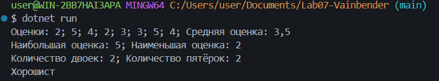
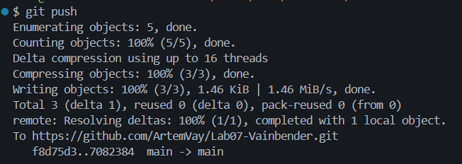

# Практическая работа №7. Массивы и foreach

**ФИО: Вайнбендер Артём Алексеевич**
**Группа: ИСП-241**
**Дата: 13.10.2026**

## Что изучено
- хранение набора однотипных значений в одном массиве.
- индексация массива начинается с нуля, последний элемент имеет индекс `Length - 1`.
- перебирание массива через `for` и `foreach`.
- как решать типовые задачи: сумма, среднее, минимум/максимум, подсчёт по
условию

## Скриншоты

